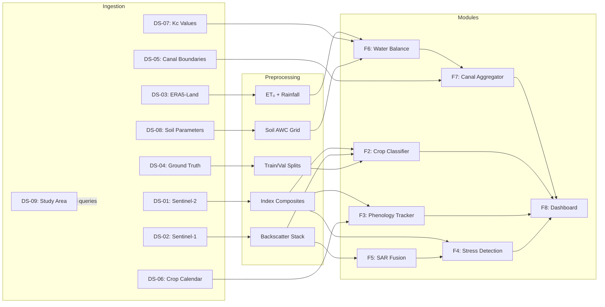

# AgriSense — Data Requirements Specification

> **Document ID:** AGRISENSE-DRS-001
> **Version:** 0.1.0-draft
> **Status:** DRAFT — Phase 0 (Project Bootstrap)
> **Last Updated:** 2026-10-23

> [!IMPORTANT]
> This document catalogues **every dataset** the AgriSense pipeline requires.
> Datasets marked **BLOCKER** must be resolved before any downstream module can
> be meaningfully validated. No study area has been defined yet — every satellite
> and reanalysis dataset access status is therefore listed as **UNCONFIRMED**.

---

## Table of Contents

1. [Overview](#1-overview)
2. [Primary Satellite Data](#2-primary-satellite-data)
   - [DS-01: Sentinel-2 MSI (Optical)](#ds-01-sentinel-2-msi-optical)
   - [DS-02: Sentinel-1 SAR (Microwave)](#ds-02-sentinel-1-sar-microwave)
   - [DS-03: ERA5-Land (Meteorological)](#ds-03-era5-land-meteorological)
3. [Required Supporting Data (Not Yet Sourced)](#3-required-supporting-data-not-yet-sourced)
   - [DS-04: Ground-Truth Labels (Crop Types)](#ds-04-ground-truth-labels-crop-types)
   - [DS-05: Canal Command Boundary Shapefiles](#ds-05-canal-command-boundary-shapefiles)
   - [DS-06: Crop Calendar / Phenology Reference](#ds-06-crop-calendar--phenology-reference)
   - [DS-07: Crop Coefficients (Kc)](#ds-07-crop-coefficients-kc)
   - [DS-08: Soil Parameters](#ds-08-soil-parameters)
   - [DS-09: Study Area Boundary](#ds-09-study-area-boundary)
4. [Data Flow Summary](#4-data-flow-summary)
5. [Data Access Verification Checklist](#5-data-access-verification-checklist)
6. [References](#6-references)

---

## 1. Overview

AgriSense ingests satellite imagery (optical and microwave), reanalysis
meteorological fields, and several ancillary vector/tabular datasets to produce:

- Crop-type maps on a nominal 10 m analysis grid (Random Forest classifier — O1, F2); grid spacing is not a claim of effective 10 m resolution
- Growth-stage timelines (phenology tracker — F3)
- Candidate stage-aware vegetation/stress indicators (F4, F5), subject to a sourced and validated method
- FAO-56 water-balance depth estimates in mm (F6); “mm/ha” appears in source documents but is not a depth unit
- Canal-command-level advisory tables (F7, O3)

The source proposes Streamlit delivery (F8). The project owner prefers a responsive browser dashboard; framework and API choices remain subject to DEC-01 approval.

The datasets fall into two tiers:

| Tier | Description | Count |
|------|-------------|-------|
| **Primary Satellite / Reanalysis** | Freely available via GEE / Copernicus | 3 |
| **Supporting / Ancillary** | Must be sourced, collected, or derived | 6 |

---

## 2. Primary Satellite Data

### DS-01: Sentinel-2 MSI (Optical)

| Attribute | Detail |
|-----------|--------|
| **Purpose** | Vegetation indices (NDVI, EVI, specifically identified `NDWI_MCF` and/or `NDWI_GAO`), crop classification features, phenology tracking, and VCI where a baseline is defined |
| **Provider** | European Space Agency (ESA) via Copernicus Open Access Hub / Google Earth Engine |
| **GEE Collection** | `COPERNICUS/S2_SR_HARMONIZED` (Level-2A, surface reflectance, harmonized across processing baselines) |
| **Relevant Bands** | See table below |
| **Native Spatial Resolution** | 10 m (visible + NIR), 20 m (red-edge + SWIR + SCL), 60 m (atmospheric bands — not used) |
| **Temporal Coverage** | Nominal revisit depends on the operating constellation and location; verify available acquisitions for the chosen AOI and dates. Cloud-free usable observations are less frequent. |
| **Units** | Surface reflectance as scaled integers; **scale factor = 0.0001** (multiply to obtain dimensionless reflectance 0–1) |
| **Coordinate Reference System** | UTM zone-specific (EPSG varies by acquisition tile, e.g., EPSG:32643 for UTM 43N) |
| **Coverage Requirements** | Full growing season(s) over the study area; at minimum one Kharif or Rabi season |
| **Access & Authentication** | Google Earth Engine account (free for research); alternatively Copernicus Data Space Ecosystem (CDSE) |
| **License** | Free and open under the [Copernicus Data Policy](https://sentinels.copernicus.eu/web/sentinel/terms-conditions) |
| **Access Confirmed** | ❌ **NO** — study area not yet defined; GEE account provisioning status unknown |

#### Band Table

| Band | Description | Resolution | Use in Pipeline |
|------|-------------|------------|-----------------|
| B2 | Blue | 10 m | EVI denominator, atmospheric scattering reference |
| B3 | Green | 10 m | `NDWI_MCF` numerator |
| B4 | Red | 10 m | NDVI, EVI numerator |
| B5 | Red Edge 1 (705 nm) | 20 m | Red-edge indices, classification features |
| B6 | Red Edge 2 (740 nm) | 20 m | Red-edge indices, classification features |
| B7 | Red Edge 3 (783 nm) | 20 m | Red-edge indices, classification features |
| B8 | NIR (842 nm) | 10 m | NDVI, EVI, `NDWI_MCF`; NIR term in `NDWI_GAO` |
| B8A | NIR narrow (865 nm) | 20 m | Narrow NIR reference, red-edge NDVI |
| B11 | SWIR 1 (1610 nm) | 20 m | Moisture-sensitive index inputs |
| B12 | SWIR 2 (2190 nm) | 20 m | Moisture-sensitive index inputs |
| SCL | Scene Classification Layer | 20 m | Cloud/shadow/snow/water masking |
| QA60 | Quality Assessment bitmask | 60 m | Opaque & cirrus cloud flags |

#### Preprocessing & QC Requirements

1. **Cloud & shadow masking** — Use SCL band to mask classes: cloud shadow (3),
   cloud medium probability (8), cloud high probability (9), thin cirrus (10).
   Cross-check with QA60 bit 10 (opaque cloud) and bit 11 (cirrus).
2. **Band resampling** — Resample 20 m bands (B5–B7, B8A, B11, B12, SCL) to
   10 m using bilinear interpolation for continuous reflectance bands; nearest-
   neighbour for SCL (categorical).
3. **Temporal compositing** — Generate cloud-free composites at 8-day or 16-day
   intervals using pixel-wise median or maximum-NDVI compositing to fill cloud
   gaps.
4. **Index computation** — Compute NDVI, EVI, and the specifically selected
   `NDWI_MCF` (Green/NIR) and/or `NDWI_GAO` (NIR/SWIR1), plus VCI only when its
   baseline is defined. Do not identify either formula using `NDWI` alone.
5. **CRS harmonisation** — Reproject all tiles to a single UTM zone covering the
   study area, or to EPSG:4326 for integration with ERA5-Land.

#### Missing-Data Handling

- Cloud gaps are an optical data-quality challenge, especially during the
  Indian monsoon (June–September). Temporal compositing may improve valid
  observation coverage; Sentinel-1 is a separate complementary measurement
  and does not fill or replace missing optical observations by default.
- If a composite period has < 1 valid observation per pixel, flag as no-data and
  preserve the gap. Any alternate sensor-derived indicator must remain separate
  and identify its source, timestamp, and method.

#### Known Limitations

- **Cloud cover** can reduce usable optical acquisitions. SAR may provide
  complementary observations, but does not guarantee equivalent or continuous
  stress information.
- **20 m → 10 m resampling** does not create genuine 10 m information for
  red-edge and SWIR bands; it only provides spatial consistency.
- **Atmospheric residuals** may persist even in the Level-2A SR product,
  especially over hazy tropical scenes.
- **Orbit overlap** — tile boundaries may cause duplicate pixels; mosaicking
  strategy must handle overlaps consistently.

#### Downstream Consumers

- Crop classifier (F2, O1)
- Phenology tracker (F3)
- Stress detection module (F4)
- VCI computation (F4)

#### Validation Needs

- Compare index time series against known phenological milestones.
- Cross-validate cloud masking effectiveness against visual inspection of
  sample scenes.
- Assess composite quality (gap fraction, temporal smoothness).

---

### DS-02: Sentinel-1 SAR (Microwave)

| Attribute | Detail |
|-----------|--------|
| **Purpose** | Complementary SAR observations (F5); VH/VV backscatter as candidate features when usable SAR acquisitions are available. SAR is not an equivalent replacement for optical measurements. |
| **Provider** | ESA via Copernicus / Google Earth Engine |
| **GEE Collection** | `COPERNICUS/S1_GRD` (Ground Range Detected, Level-1) |
| **Relevant Bands** | VV (co-polarisation), VH (cross-polarisation) |
| **Pixel spacing / effective resolution** | Earth Engine GRD may use 10 m pixel spacing; IW effective ground resolution is coarser (about 20 × 22 m). Record both the product spacing and effective resolution; do not describe 10 m spacing as 10 m detail. |
| **Temporal Coverage** | Acquisition availability depends on constellation, orbit, location, and selected pass direction; inspect the archive for the chosen AOI and date range rather than assume a fixed revisit interval. |
| **Units** | σ⁰ (sigma-naught) in **decibels (dB)** — already radiometrically calibrated and terrain-corrected in the GEE GRD collection |
| **Coordinate Reference System** | UTM zone-specific (EPSG varies by acquisition) |
| **Coverage Requirements** | Same temporal extent as Sentinel-2; prioritise consistent orbit direction (ascending OR descending, not mixed) unless dual-orbit analysis is explicitly designed |
| **Access & Authentication** | Google Earth Engine account (same as DS-01) |
| **License** | Free and open under Copernicus Data Policy |
| **Access Confirmed** | ❌ **NO** — study area not yet defined |

#### Preprocessing & QC Requirements

1. **Orbit filtering** — Select a single orbit direction (ascending or
   descending) for temporal consistency, unless the pipeline explicitly accounts
   for viewing-geometry differences.
2. **Speckle filtering** — Apply a spatial filter (Refined Lee, Lee sigma, or
   boxcar) to reduce multiplicative speckle noise. Window size typically 5×5 or
   7×7.
3. **Terrain correction** — Already applied in the GEE GRD product (Range-
   Doppler terrain correction using SRTM 30 m DEM). Verify in mountainous
   terrain.
4. **Temporal stacking** — Build multi-temporal backscatter stacks aligned to
   the same 8-day or 16-day periods as the Sentinel-2 composites.
5. **VH/VV ratio** — Compute the cross-ratio (VH/VV or VH − VV in dB) as an
   additional feature for classification and moisture proxy.

#### Missing-Data Handling

- SAR can acquire observations through cloud, but coverage and usable observations are not guaranteed for every place or interval. However:
  - Orbit coverage is not uniform globally — some regions may only have 12-day
    revisit.
  - Ascending vs. descending passes may observe different scattering behaviour
    due to look-angle and illumination geometry.
- If a SAR acquisition is missing for a composite period, preserve the gap and
  quality flag. Do not silently substitute a neighboring observation; any temporal
  compositing or interpolation rule must be specified and evaluated.

#### Known Limitations

- **Speckle noise** is inherent to coherent imaging and degrades spatial detail
  even after filtering.
- SAR backscatter is **simultaneously sensitive** to soil moisture, surface
  roughness, and vegetation structure; these influences cannot be separated by
  treating VH/VV as a direct soil-moisture measurement.
- **Crop-type discrimination** from SAR alone is region-dependent; SAR is a complementary feature. Any use for stress inference when optical data are missing requires a separately validated method and must not be described as an optical observation.
- **Interpretation complexity** — temporal backscatter signatures are crop- and
  region-specific and require careful calibration.

#### Downstream Consumers

- Candidate SAR-optical fusion (F5), subject to validation
- Crop classifier (F2, O1) — as auxiliary features
- Irrigated area proxy (indirect, via temporal VH patterns)

#### Validation Needs

- Compare SAR-derived temporal profiles against known crop calendars.
- Assess speckle filter impact on classification accuracy (filtered vs.
  unfiltered).
- Verify terrain correction quality in areas with significant topographic relief.

---

### DS-03: ERA5-Land (Meteorological)

| Attribute | Detail |
|-----------|--------|
| **Purpose** | Reference evapotranspiration (ET₀) calculation via FAO-56 Penman-Monteith; rainfall data for water balance (F6); temperature for phenology models |
| **Provider** | ECMWF via Copernicus Climate Data Store (CDS) / Google Earth Engine |
| **GEE Collection** | `ECMWF/ERA5_LAND/DAILY_AGGR` (daily aggregates) or `ECMWF/ERA5_LAND/HOURLY` |
| **Key Variables** | See table below |
| **Native Spatial Resolution** | Approximately 0.1° grid; Earth Engine documents a nominal 11,132 m pixel size. Physical ground dimensions vary with latitude and projection. |
| **Native Temporal Resolution** | `DAILY_AGGR` provides daily aggregate assets; use of `HOURLY` is a separate collection/query choice and requires its own aggregation rules. |
| **Units** | SI — see variable table |
| **Coordinate Reference System** | Regular latitude/longitude grid (EPSG:4326) |
| **Coverage Requirements** | Same temporal extent as satellite data; global coverage, subset to study area |
| **Access & Authentication** | GEE (same account) or CDS API (free registration required at [cds.climate.copernicus.eu](https://cds.climate.copernicus.eu)) |
| **License** | Copernicus Climate Data Store Licence (free for research and commercial use with attribution) |
| **Access Confirmed** | ❌ **NO** — study area not yet defined; CDS API key not provisioned |

> **Source references:** [Earth Engine ERA5-Land Daily Aggregates catalog](https://developers.google.com/earth-engine/datasets/catalog/ECMWF_ERA5_LAND_DAILY_AGGR) for current collection bands, units, grid size, and known accumulated-band quality issues; [FAO-56 Chapter 2](https://www.fao.org/4/x0490e/x0490e06.htm) for the Penman-Monteith input terms. These references define candidate inputs, not a locally validated ET₀ product.

#### Variable Table

| Variable | ERA5-Land Name | Units | Use |
|----------|---------------|-------|-----|
| 2 m air temperature (daily mean/minimum/maximum) | `temperature_2m`, `temperature_2m_min`, `temperature_2m_max` | K | Temperature terms in ET₀ calculation; document which are used |
| 2 m dewpoint temperature | `dewpoint_temperature_2m` | K | Humidity / actual vapour pressure term, with documented calculation |
| Surface pressure | `surface_pressure` | Pa | Psychrometric constant term, with documented conversion |
| 10 m u/v wind components | `u_component_of_wind_10m`, `v_component_of_wind_10m` | m/s | Wind speed; FAO-56 uses 2 m wind, so document height adjustment |
| Net solar / thermal radiation | `surface_net_solar_radiation_sum`, `surface_net_thermal_radiation_sum` | J/m² | Candidate net-radiation inputs; verify sign convention and daily energy conversion |
| Downward solar / thermal radiation (if required by method) | `surface_solar_radiation_downwards_sum`, `surface_thermal_radiation_downwards_sum` | J/m² | Radiation terms; incoming solar alone is not net radiation |
| Total precipitation | `total_precipitation_sum` | m | Daily precipitation depth; convert to mm and compute effective rainfall only with a separate approved method |

#### Preprocessing & QC Requirements

1. **ET₀ computation** — If FAO-56 Penman-Monteith is selected, implement it
   using documented inputs and conversions. Convert temperature from K to °C;
   derive vapor-pressure and wind terms with stated methods; convert daily
   energy from J/m² to MJ/m²; compute/use net radiation rather than treating
   incoming solar radiation as net radiation; and document pressure/elevation,
   wind-height, and daily soil-heat-flux handling. Validate the implementation
   against the selected method's documented examples before scientific use.
2. **Temporal aggregation** — Daily aggregates already represent daily assets.
   If the hourly collection is selected, define and document aggregation for
   precipitation/energy sums and temperature, humidity, wind, and pressure.
3. **Spatial alignment** — Retain ERA5-Land native-grid identity and native resolution. If raster alignment requires resampling, use a documented method and preserve the source-cell provenance; do not interpret resampled pixels as finer meteorological observations.

> [!CAUTION]
> **Resolution mismatch warning:** Resampling ERA5-Land from its approximately
> 0.1° native grid to 10 m does
> **NOT** create genuine finer-resolution meteorological information. Every 10 m
> pixel within the same ~9 km ERA5 grid cell will receive identical ET₀ and
> rainfall values. This is a necessary spatial alignment step, not a
> downscaling. All documentation and outputs must clearly state the effective
> meteorological resolution remains ~9 km.

#### Missing-Data Handling

- ERA5-Land is a **reanalysis product** (model-generated); actual temporal coverage and missing values must be checked for the requested collection and interval.
- The Earth Engine catalog documents occasional implausible negative or excessive values in accumulated flow bands. Preserve source values, flag suspect records, and define any handling method; do not silently clip, carry precipitation forward, or impute weather inputs.
- If gaps occur, retain missing-data flags and investigate the cause. Any approved imputation must be documented and evaluated.

#### Known Limitations

- **Coarse resolution** (~9 km) — cannot capture microclimatic variations
  (valley vs. ridge, irrigated vs. rainfed fields nearby).
- **Reanalysis biases** — ERA5-Land may systematically over- or under-estimate
  precipitation, temperature, or radiation compared to local weather station
  observations. Bias-correction against ground stations is recommended if
  available.
- **Land-surface model assumptions** — ERA5-Land uses the HTESSEL land-surface
  model, which may not accurately represent local soil and vegetation conditions.
- **Precipitation timing** — Daily aggregates may not capture diurnal
  convective patterns accurately.

#### Downstream Consumers

- FAO-56 water balance module (F6)
- Irrigation deficit calculator (F6, F7, O3)
- Phenology tracker (F3) — accumulated thermal time / GDD

#### Validation Needs

- If local weather station data is available, compare ERA5-Land temperature,
  rainfall, and computed ET₀ against station records.
- Assess sensitivity of deficit estimates to ERA5-Land precipitation bias.

---

## 3. Required Supporting Data (Not Yet Sourced)

> [!WARNING]
> None of the datasets in this section have confirmed sources. Several are
> **blockers** — without them, key pipeline modules cannot be validated or
> operated. Resolving these is a **Phase 0 priority**.

### DS-04: Ground-Truth Labels (Crop Types)

| Attribute | Detail |
|-----------|--------|
| **Purpose** | Training and validation of the Random Forest crop-type classifier (F2, O1) |
| **Provider / Source** | ❓ **UNKNOWN** — must be field-collected, obtained from agricultural department records, or derived from very high resolution imagery interpretation |
| **Requirements** | Georeferenced point or polygon samples with confirmed crop type, cropping season (Kharif/Rabi/Zaid), and collection date |
| **Sample Size** | Not specified by the source PDFs. Determine from label availability, spatial design, class distribution, and validation needs; do not treat a generic count as a guarantee of adequacy. |
| **Spatial Format** | GeoJSON, Shapefile, or GeoPackage with CRS metadata |
| **Temporal Alignment** | Must correspond to the same season as the satellite imagery used for classification |
| **Preprocessing** | Verify label source, date, positional and class uncertainty; keep spatially independent evaluation labels outside model fitting. Split proportions are to be selected and documented based on the independent validation design. |
| **Missing-Data Handling** | Preserve uncertain, conflicting, or incomplete labels with quality metadata; exclude or separately handle them under the approved training/evaluation protocol rather than silently assigning a class. |
| **License** | Depends on source; government records may have restricted redistribution |
| **Access Confirmed** | ❌ **NO** |
| **Status** | 🔴 **BLOCKER** for classification validation |

> [!CAUTION]
> **Critical gap:** Neither reference PDF identifies a ground-truth data source. Without appropriate labels, supervised model fitting and credible independent accuracy evaluation cannot be claimed. Software tests with synthetic fixtures do not resolve this scientific evidence gap.

**Potential Sources to Investigate:**

- State agriculture department crop survey records
- ICAR / Krishi Vigyan Kendra field reports
- Bhuvan (NRSC/ISRO) crop layer products
- Manual interpretation of Google Earth / high-res commercial imagery
- Direct field campaigns with GPS-enabled mobile apps (e.g., KoBoToolbox, ODK)

---

### DS-05: Canal Command Boundary Shapefiles

| Attribute | Detail |
|-----------|--------|
| **Purpose** | Spatial aggregation of pixel-level irrigation deficits to minor canal command areas for advisory output (F7, O3) |
| **Provider / Source** | ❓ **UNKNOWN** — likely from the local Irrigation Department, Command Area Development Authority (CADA), India-WRIS, or state water resources department |
| **Requirements** | Polygon geometries delineating minor canal command areas, with unique identifiers (canal name/code) and optional attributes (designed discharge, command area in hectares) |
| **Spatial Format** | Shapefile, GeoJSON, or GeoPackage |
| **CRS** | Any standard CRS with metadata (will be reprojected to match the analysis grid) |
| **Preprocessing** | Validate topology (no gaps, no overlaps within the command area); verify attribute completeness; clip to study area |
| **Missing-Data Handling** | If minor boundaries are unavailable, use a verified major canal/distributary boundary only when its geography and role are known, and label the output at that level. Do not substitute administrative areas and call them canal commands. |
| **License** | Government data; may require formal data-sharing agreement or RTI request |
| **Access Confirmed** | ❌ **NO** |
| **Status** | 🔴 **BLOCKER** for canal-level advisory (F7, O3) |

---

### DS-06: Crop Calendar / Phenology Reference

| Attribute | Detail |
|-----------|--------|
| **Purpose** | Defining expected growth stages, assigning temporal windows for stage-aware stress thresholds (F3, F4), and mapping Kc values to growth stages (F6) |
| **Provider / Source** | ❓ **UNKNOWN** — potential sources include FAO crop calendars, state agriculture department seasonal guides, ICAR publications, or IIPR/IIWBR crop manuals |
| **Requirements** | Crop-specific sowing dates (typical range), stage durations (initial, development, mid-season, late), harvesting dates, and regional adjustments for the study area |
| **Format** | Tabular (CSV, JSON) with columns: crop_type, region, season, stage, start_day, end_day, typical_duration_days |
| **Preprocessing** | Cross-reference with NDVI phenology curves derived from historical Sentinel-2 data; adjust dates for the specific study year |
| **Missing-Data Handling** | Do not silently assign a generic calendar. A literature-based calendar may be evaluated as a clearly labelled candidate only after matching the crop, region, and season; retain uncertain stage assignments when local timing is unverified. |
| **License** | Typically public domain (FAO, government publications) |
| **Access Confirmed** | ❌ **NO** |
| **Status** | 🟡 **Required** — phenology validation and Kc assignment depend on this |

---

### DS-07: Crop Coefficients (Kc)

| Attribute | Detail |
|-----------|--------|
| **Purpose** | FAO-56 water balance calculation: ETc = Kc × ET₀ (F6) |
| **Provider / Source** | FAO Irrigation and Drainage Paper No. 56 (Allen et al., 1998) provides standard tabulated values. Local calibration from Indian agricultural research institutions (ICAR, state agricultural universities) may refine values. |
| **Requirements** | Kc_ini, Kc_mid, Kc_end for each target crop type; stage durations; adjustment factors for local climate and cultivation practices |
| **Format** | Tabular (CSV, JSON) with columns: crop_type, stage, kc_value, stage_duration_days |
| **Preprocessing** | Map tabulated Kc stages to the phenology stages from DS-06; apply climate corrections per FAO-56 methodology if Kc_mid or Kc_end differ from standard conditions |
| **Missing-Data Handling** | Use FAO-56 generic values as defaults; clearly document any locally calibrated values and their provenance |
| **License** | FAO-56 values are published and freely citeable |
| **Access Confirmed** | 🟡 **PARTIAL** — generic FAO-56 values are available in published literature; local calibration is unconfirmed |
| **Status** | 🟡 **Required** — generic values available; local calibration may improve accuracy |

---

### DS-08: Soil Parameters

| Attribute | Detail |
|-----------|--------|
| **Purpose** | Effective rainfall calculation and soil water holding capacity for the FAO-56 water balance; root-zone available water determines deficit sensitivity |
| **Provider / Source** | ❓ **UNKNOWN** — possible sources such as SoilGrids, NBSS&LUP maps, or local soil surveys require separate availability, resolution, date, suitability, and license verification before selection |
| **Key Variables** | Field capacity (FC), permanent wilting point (PWP), available water capacity (AWC = FC − PWP), soil texture class, soil depth |
| **Spatial Resolution** | Unknown until a source is selected and verified; retain the selected source's native support and limitations |
| **Units** | Volumetric water content (cm³/cm³ or mm/m depth) |
| **Preprocessing** | If available and needed by the approved method, document variables, depth support, units, source quality, and any spatial alignment; do not infer root-zone storage from unspecified depths |
| **Missing-Data Handling** | Do not silently substitute a global product or regional default. If required inputs are unavailable, omit the affected balance term and state that a complete root-zone balance cannot be estimated. |
| **License** | Unknown until a source is selected and its current terms are verified |
| **Access Confirmed** | ❌ **NO** |
| **Status** | 🟡 **Recommended** — not mentioned in source PDFs but architecturally important for defensible water balance |

> [!NOTE]
> Neither reference PDF mentions soil parameters. This dataset is an
> **Architect recommendation** to support water-balance methods that require
> soil storage. If such data are unavailable, do not assume uniform soil
> properties; restrict outputs to the terms the selected method can support.

---

### DS-09: Study Area Boundary

| Attribute | Detail |
|-----------|--------|
| **Purpose** | Define the geographic extent for all data queries, processing, and output products |
| **Provider / Source** | ❓ **UNKNOWN** — must be defined by the project team |
| **Requirements** | A single polygon (or multipolygon) delineating the study area, in a standard geospatial format |
| **Spatial Format** | GeoJSON or Shapefile |
| **CRS** | EPSG:4326 (WGS84) or the project's chosen UTM zone |
| **Preprocessing** | None — this is a primary input that gates all other data acquisition |
| **Missing-Data Handling** | N/A — cannot proceed without a defined study area |
| **License** | N/A |
| **Access Confirmed** | ❌ **NO** |
| **Status** | 🔴 **BLOCKER** — no study area is specified in either reference PDF; this must be the first decision made |

> [!CAUTION]
> **Foundational dependency:** The study area boundary determines which
> Sentinel-2 tiles, Sentinel-1 orbits, and ERA5-Land grid cells to query. It
> also determines the UTM zone, the relevant canal command boundaries, crop
> types, and cropping seasons. **No data acquisition or pipeline development can
> begin until this is defined.**

---

## 4. Data Flow Summary

The following table traces each dataset through the pipeline from ingestion to
the module(s) that consume its derived products.

| Dataset | Preprocessing Steps | Output Product | Consumer Module(s) |
|---------|-------------------|----------------|-------------------|
| **DS-01** Sentinel-2 | Cloud masking → Band resampling (20m→10m) → Temporal compositing (candidate 8/16-day windows) → Index computation | NDVI, EVI, selected `NDWI_MCF` / `NDWI_GAO`, and VCI only with a defined baseline | Crop classifier (F2), Phenology tracker (F3), candidate stress indicators (F4) |
| **DS-02** Sentinel-1 | Orbit filtering → Speckle filtering → Temporal stacking → VH/VV ratio | Multi-temporal backscatter stack (GeoTIFF) | SAR fusion module (F5), Crop classifier (F2) as auxiliary features |
| **DS-03** ERA5-Land | Unit conversion → ET₀ via FAO-56 Penman-Monteith → Daily aggregation → Spatial resampling | Daily ET₀ and precipitation grids (GeoTIFF) | Water balance module (F6) |
| **DS-04** Ground Truth | Provenance and quality review → documented spatial/temporal split design | Labelled sample set (GeoJSON) | Crop classifier training and independent evaluation (F2, O1) |
| **DS-05** Canal Boundaries | Topology validation → Attribute check → Study area clipping | Canal command polygons (GeoJSON) | Canal aggregator (F7, O3), Dashboard (F8) |
| **DS-06** Crop Calendar | Cross-reference with NDVI phenology → Regional adjustment | Stage lookup table (CSV/JSON) | Phenology tracker (F3), Kc assignment (F6) |
| **DS-07** Kc Values | Map to phenology stages → Climate correction | Kc lookup table (CSV/JSON) | Water balance module (F6): ETc = Kc × ET₀ |
| **DS-08** Soil Parameters | Source review → select parameters/method → preserve source resolution and assumptions | Soil/available-water inputs only if acquired and approved | Water-balance module (F6): storage terms when its method requires them |
| **DS-09** Study Area | None (primary input) | AOI polygon (GeoJSON) | All modules — gates data acquisition |

---

## 5. Data Access Verification Checklist

| ID | Dataset | Status | Action Required to Confirm |
|----|---------|--------|--------------------------|
| DS-01 | Sentinel-2 MSI | ❌ UNCONFIRMED | Define study area → identify required tiles → verify GEE account access → test query for date range |
| DS-02 | Sentinel-1 SAR | ❌ UNCONFIRMED | Define study area → identify orbit coverage (ascending/descending) → verify GEE access → test query |
| DS-03 | ERA5-Land | ❌ UNCONFIRMED | Define study area → verify GEE access OR provision CDS API key → test data download for date range |
| DS-04 | Ground Truth Labels | ❌ UNCONFIRMED | Identify source (field survey, government records, VHR imagery) → acquire samples → validate GPS accuracy |
| DS-05 | Canal Command Boundaries | ❌ UNCONFIRMED | Contact local irrigation department or CADA → request shapefiles → verify topology and coverage |
| DS-06 | Crop Calendar | ❌ UNCONFIRMED | Identify target crops → obtain regional phenology guides from FAO, state agriculture dept, or ICAR |
| DS-07 | Crop Coefficients (Kc) | 🟡 PARTIAL | Generic FAO-56 values available → confirm target crop list → check for locally calibrated values |
| DS-08 | Soil Parameters | ❌ UNCONFIRMED | Evaluate SoilGrids coverage over study area → download and validate AWC estimates → compare with local soil surveys if available |
| DS-09 | Study Area Boundary | ❌ UNCONFIRMED | **Team decision required** → create GeoJSON polygon → commit to repository |

> [!IMPORTANT]
> **Key scientific/operational dependencies** include DS-04 (labels), DS-05 (canal boundaries, if canal summaries remain in scope), and DS-09 (study area). DS-09 is foundational for regional data-access checks. Synthetic software work may proceed after contract approval, but it is not scientific validation.

---

## 6. References

1. Allen, R.G., Pereira, L.S., Raes, D. and Smith, M. (1998). *Crop
   Evapotranspiration: Guidelines for Computing Crop Water Requirements*. FAO
   Irrigation and Drainage Paper No. 56. Rome: FAO.
2. ESA Sentinel-2 User Handbook. European Space Agency.
   https://sentinels.copernicus.eu/web/sentinel/user-guides/sentinel-2-msi
3. ESA Sentinel-1 User Handbook. European Space Agency.
   https://sentinels.copernicus.eu/web/sentinel/user-guides/sentinel-1-sar
4. Muñoz Sabater, J. (2019). *ERA5-Land hourly data from 1950 to present*.
   Copernicus Climate Change Service (C3S) Climate Data Store (CDS).
   https://doi.org/10.24381/cds.e2161bac
5. Hengl, T. et al. (2017). *SoilGrids250m: Global gridded soil information
   based on machine learning*. PLOS ONE, 12(2), e0169748.
6. Google Earth Engine Data Catalog. https://developers.google.com/earth-engine/datasets

---

> [!NOTE]
> The reference PDFs (`IDP_Review_1_AgriSense (1).pdf` and `mava.pdf`) are
> maintained outside the repository and **must not be committed** to version
> control. They are documented in [`docs/references/README.md`](file:///c:/Users/rishav%20raj/Desktop/project/agrisense/docs/references/README.md).
